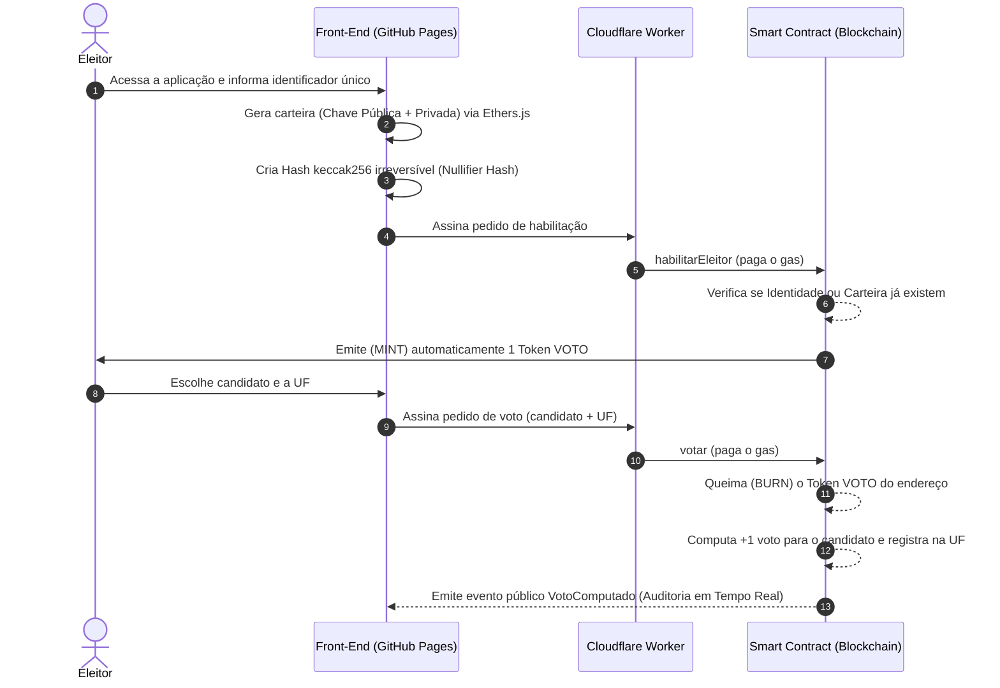

# 🗳️ Eleições Presidenciais Web3 — Simulador de 2º Turno On-Chain


> **E se o segundo turno das eleições presidenciais brasileiras ocorresse em uma blockchain pública?**
> Este projeto é uma Prova de Conceito (PoC) 100% descentralizada e executada no navegador (hospedada via GitHub Pages) que demonstra, de forma prática e transparente, como contratos inteligentes, criptografia assimétrica e tokenização podem ser aplicados a um processo eleitoral auditável em tempo real.

---

## 🎯 Objetivo do Projeto

Demonstrar de forma simplificada e visual os pilares de uma votação baseada em blockchain (**Imutabilidade**, **Transparência**, **Resistência à Censura** e **Prevenção de Gasto Duplo**), permitindo que qualquer pessoa acesse a aplicação sem conhecimento prévio de Web3, gere sua identidade criptográfica e registre seu voto *on-chain*.

---

## ⚙️ Como Funciona (Fluxo do Eleitor)

O sistema opera através de um ciclo de vida de token único (**Mint & Burn**) combinado com validação geográfica de privacidade preservada:



### As 4 Regras de Ouro do Protocolo

1. **Identidade Criptográfica Única**: Ao acessar o sistema, o navegador gera localmente um par de chaves (Chave Pública e Chave Privada). Um Nullifier Hash (`keccak256`) garante que o mesmo indivíduo não consiga gerar múltiplos endereços habilitados.

2. **Emissão Automática (1 Eleitor = 1 Token)**: Assim que o endereço único é validado pelo Smart Contract, ele recebe automaticamente 1 Token de Voto intransferível.

3. **Queima no Voto (Proof of Burn)**: Para votar em Luiz Inácio "Lula" da Silva (13), Flávio Bolsonaro (22) ou Branco/Nulo, o eleitor utiliza seu token. O contrato inteligente queima (destrói) o token no exato momento do voto, tornando matematicamente impossível votar duas vezes.

4. **UF informada pelo eleitor**: O eleitor escolhe a sigla do Estado em um seletor (sem GPS). Só a UF de duas letras vai on-chain, permitindo apuração regional sem expor endereço residencial.

---

## 🏗️ Arquitetura Técnica (Serverless & Static)

Para rodar inteiramente no GitHub Pages sem depender de servidores de banco de dados tradicionais, a arquitetura foi desenhada sob o paradigma **Client-Side Web3**:

| Camada | Tecnologia | Função |
| --- | --- | --- |
| Interface & Urna | HTML5, CSS e JavaScript Vanilla (ES6 Modules) | Interface hospedada no GitHub Pages |
| Carteira Invisível | ethers.js (v6) | Gera o par de chaves no navegador, sem MetaMask |
| Trava de Unicidade | Hash keccak256 (`ethers.id`) | Transforma o identificador em Nullifier Hash único |
| UF do eleitor | `<select>` com as 27 UFs | Entrada direta da sigla antes de gravar on-chain |
| Consenso e Dados | Solidity ^0.8.20 (Sepolia) | Mint, burn e apuração imutável |
| Taxa de Rede (Gas) | Cloudflare Worker (Relayer) | Patrocina o gas das carteiras recém-criadas |

> **Meta-transações:** como a carteira do eleitor nasce sem ETH, o Relayer envia a transação. O contrato autentica o eleitor pela assinatura EIP-191 (`personal_sign`) dos pedidos `habilitar` e `votar`, em vez de confiar em `msg.sender` (que seria o próprio Relayer).

---

## 🔍 Transparência vs. Sigilo: Protótipo vs. Mundo Real (TSE)

Este projeto tem caráter **educacional e demonstrativo**. Abaixo, como este protótipo simplifica o processo e como uma implementação estatal oficial resolveria os desafios de privacidade:

| Requisito Eleitoral | Como funciona neste Projeto (Didático) | Como seria em uma Eleição Oficial em Blockchain |
| --- | --- | --- |
| Autenticação única | Hash keccak256 gerado a partir de um identificador no cliente | Integração oficial com ICP-Brasil / Gov.br emitindo credenciais anônimas |
| Transparência vs. Coação | O evento `VotoComputado` mostra o endereço público, a UF e a escolha para facilitar a visualização no painel | Uso de Zero-Knowledge Proofs (zk-SNARKs): o contrato prova que o token foi queimado e soma o voto, mas oculta criptograficamente qual carteira votou em qual candidato |
| Custos de Rede (Gas) | Rede de testes pública (Sepolia) com patrocínio via Relayer | Rede permissionada soberana (nós do TSE, STF, OAB, universidades, partidos e Forças Armadas) com taxa zero |

> **Sobre o identificador:** Em um cenário real, a validação seria feita pela API OAuth do Gov.br emitindo uma assinatura criptográfica cega (*Blind Signature*). Neste protótipo didático, o hash do identificador representa esse papel. Qualquer pessoa pode digitar identificadores de teste — o objetivo é demonstrar o protocolo Mint & Burn, não autenticar eleitores reais.

---

## 🚀 Como Executar o Projeto Localmente

Como o projeto foi construído para o GitHub Pages, ele não exige etapas complexas de build:

1. Clone este repositório:
   ```bash
   git clone https://github.com/francissantiago/Urna-Web3.git
   cd Urna-Web3
   ```

2. Inicie qualquer servidor HTTP estático:
   ```bash
   # Usando Python 3
   python -m http.server 8000

   # Ou usando Node.js (npx)
   npx serve .
   ```

3. Abra o navegador em `http://localhost:8000`.

### Testes do Smart Contract

```bash
cd contracts
npm install
npx hardhat test
```

### Deploy do Contrato (Sepolia)

1. Configure `contracts/.env` a partir de `contracts/.env.example` (chave privada de deploy e URL RPC).
2. Execute:
   ```bash
   cd contracts
   npx hardhat run scripts/deploy.js --network sepolia
   ```
3. Copie o endereço emitido para `assets/js/config.js` (`CONTRACT_ADDRESS`).

### Deploy do Relayer (Cloudflare Worker)

1. Entre em `worker/`, configure `.dev.vars` a partir de `.dev.vars.example`.
2. Publique com Wrangler:
   ```bash
   cd worker
   npx wrangler deploy
   ```
3. Atualize `RELAYER_URL` em `assets/js/config.js` com a URL do Worker.

### GitHub Pages

Ative Pages na raiz do repositório (branch `main` / pasta `/`). O site é 100% estático; o contrato e o Worker precisam estar publicados na Sepolia.

---

## 📁 Estrutura do Repositório

```
index.html                 # Interface (Identidade, Urna e Painel de Auditoria)
assets/
  css/
    styles.css             # Estilização complementar
  js/
    config.js              # Endereço do contrato, RPC e URL do Relayer
    wallet.js              # Geração de chaves e hash de identidade
    geo.js                 # Validação e lista das UFs
    contract.js            # ABI, leituras e escuta de eventos
    relayer.js             # Assinatura e envio ao Worker
    app.js                 # Orquestração da UI
contracts/
  contracts/
    EleicaoSegundoTurno.sol # Smart Contract
  test/                    # Testes Hardhat
  scripts/deploy.js        # Deploy na Sepolia
worker/
  src/index.js             # Relayer (paga o gas)
  wrangler.toml            # Configuração Cloudflare
README.md
LICENSE
```

---

## 📜 Licença

Distribuído sob a licença MIT. Sinta-se livre para fazer um fork, auditar o contrato inteligente e propor melhorias via Pull Requests.
